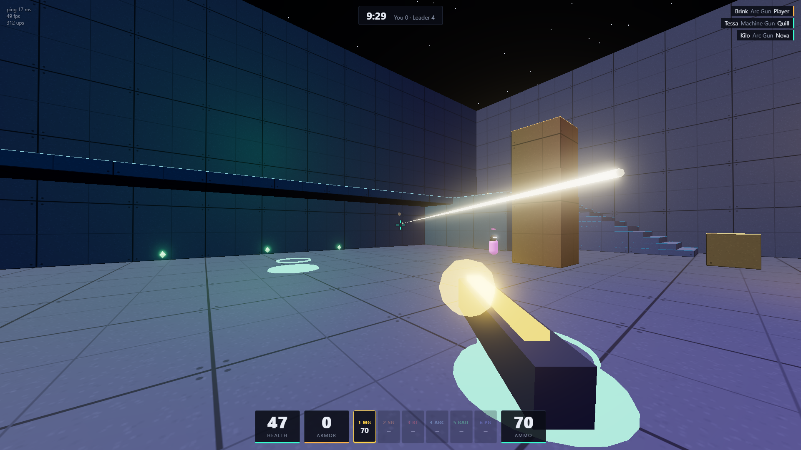
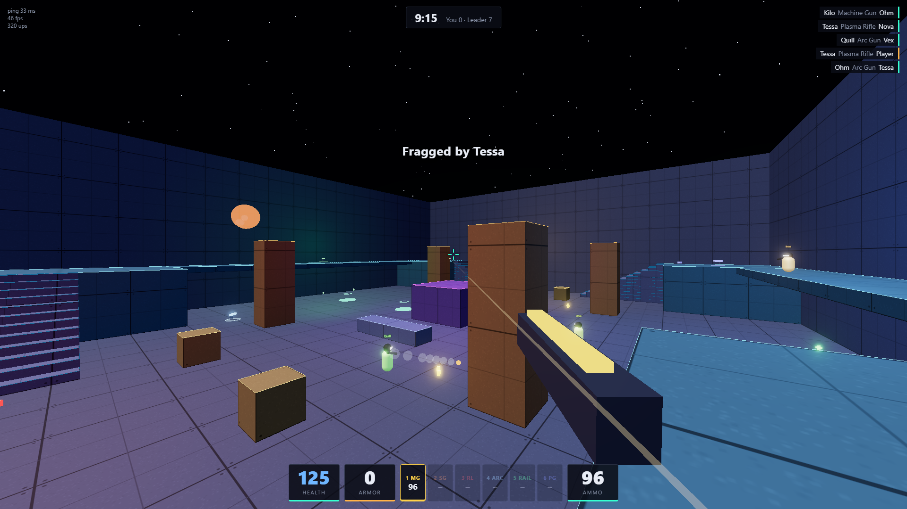

# Slipstream Arena

Slipstream Arena is an original arena shooter for the browser.
It uses the gameplay rules of the classic arena shooters of 1999:

- Fast movement with air strafe speed gain, rocket jumps, and jump pads.
- Seven weapons (a melee hammer and six guns), armor, health, and one power item (the Amplifier) on timers.
- Free-for-all deathmatch with a frag limit and a time limit.
- Bots for offline play and for the dedicated server.

The client uses [three.js](https://threejs.org/) (WebGL). The dedicated server uses Node.js and WebSocket.
The client and the server use the same simulation code in `shared/`.

## Screenshots



| | |
| --- | --- |
|  |  |
|  |  |

## Requirements

- Node.js 22 or later.
- A browser with WebGL 2.

## Quick start

```sh
npm install
npm start
```

`npm start` builds the client and starts the dedicated server.
Open `http://localhost:27960` in a browser. Then select "Play offline" or "Connect".

## Controls

| Key | Action |
| --- | --- |
| W, A, S, D | Move |
| Space | Jump |
| Mouse | Aim |
| Left mouse button | Fire |
| 1 to 7, mouse wheel | Select a weapon |
| C, right mouse button | Zoom while you hold it |
| Tab | Show the scores |
| Enter | Chat |
| Esc | Open the menu |

To gain speed, jump again and again. In the air, hold forward and one strafe key, and turn slowly to the strafe side.
The HUD shows the speed in units per second ("ups"). The ground speed limit is 320.

## Weapons

| Key | Weapon | Notes |
| --- | --- | --- |
| 1 | Hammer | Melee weapon. 50 damage at contact range. It uses no ammo, and each player always has it. |
| 2 | Machine Gun | 7 damage for each bullet, 10 bullets each second. Each player starts with it. |
| 3 | Shotgun | 11 pellets with 10 damage each. |
| 4 | Rocket Launcher | 100 damage and splash damage. The blast pushes players (rocket jump). |
| 5 | Arc Gun | Continuous beam with a range of 768 units. |
| 6 | Railgun | 100 damage. The slug goes through all players on the line. |
| 7 | Plasma Rifle | 20 damage for each ball, 10 balls each second. |

If the weapon in the hand has no ammo, the game selects a different weapon. The hammer is the last option.

## Offline play

The menu has the bot setup for the offline mode:

- "Bots" sets the bots to on or off.
- "Bot count" sets the number of bots (1 to 15).
- "Bot skill" sets the skill (1 to 5). A higher skill reacts faster, aims better, and does more damage.
  Skill 5 does the full weapon damage. Skill 1 does 40% of it.
- "Double jump" lets each player jump one more time in the air.
- "Instakill" gives each player only the Hammer and the Railgun. A Railgun hit kills at once. The map has no items.

During an offline game, press Esc, change the setup, and select "Apply bot setup".

## Maps

| Id | Name | Description |
| --- | --- | --- |
| `yard` | Crossfire Yard | A large open arena with four corner platforms, for 4 to 12 players. |
| `deck` | Twin Deck | A small arena with a balcony and a bridge, for 2 to 4 players. |
| `hall` | Long Hall | A long arena with a gallery on each side and a bridge in the middle, for 4 to 8 players. Good for long shots. |
| `core` | High Core | A tower with two levels in the middle of an open ring, for 4 to 8 players. The Amplifier is on the top. |
| `cross` | Cross Guard | A cross of thick walls makes four rooms, for 4 to 8 players. The players can walk on the top of the walls. |

The offline menu has a "Map" option: one map, or all maps in rotation.
`shared/map.js` contains the maps. A map is a list of boxes, items, spawn points, jump pads, and navigation points.
After a change, run `node tools/map-check.mjs`. It checks that no point is in a box and that the bots can go to each item.

## Performance graph

Press F3, or set "Performance graph" in the menu, to show the frame time graph.

- Each column is one frame. A red column is a slow frame.
- Orange is the simulation, green is the draw code, and grey is the time that the browser and the GPU use.
- "Save performance log" in the menu saves a JSON file with each slow frame and its cause.
- An online client sends a summary to the server each 10 seconds. The server writes it to its log as a `perf` line.
- The server writes its tick times to the log one time each minute. The `status` command shows them also.

## Graphics quality

The "Graphics" option in the menu limits the render resolution. The default is "Medium" (approximately 1080p).
On a 4K screen with an integrated GPU, "Native resolution" can decrease the frame rate below 60.

## Dedicated server

```sh
npm run build      # Build the web client one time.
npm run server -- --port 27960 --bots 4 --fraglimit 20
```

The server serves the web client and accepts WebSocket connections on the same port.
The server compresses the files of the web client with Brotli or gzip. A reverse proxy does not have to compress them.
The server stops the simulation when no human player is connected.

| Option | Environment | Default | Description |
| --- | --- | --- | --- |
| `--port` | `PORT` | 27960 | TCP port for HTTP and WebSocket. |
| `--host` | `HOST` | 0.0.0.0 | Network address. |
| `--name` | `SERVER_NAME` | Slipstream Arena server | Server name. |
| `--maxclients` | `MAX_CLIENTS` | 12 | Maximum number of human players. |
| `--bots` | `BOTS` | 4 | Number of bots (0 to 15). 0 sets the bots to off. |
| `--botskill` | `BOT_SKILL` | 3 | Bot skill (1 to 5). |
| `--botfill` | `BOT_FILL` | on | `on`: a bot leaves when a player joins. `off`: the bot count is constant. |
| `--doublejump` | `DOUBLE_JUMP` | off | `on`: a player can jump one more time in the air. The server sends this setting to the clients. |
| `--instakill` | `INSTAKILL` | off | `on`: each player has only the Hammer and the Railgun. A Railgun hit kills at once. The Railgun uses no ammo, and the map has no items. |
| `--fraglimit` | `FRAG_LIMIT` | 20 | Frags that end a match. 0 sets no limit. |
| `--timelimit` | `TIME_LIMIT` | 10 | Match time in minutes. 0 sets no limit. |
| `--maps` | `MAPS` | all maps | Map rotation, a list with commas. The first map starts. After each match, the server goes to the next map. |
| `--votes` | `VOTES` | on | `on`: players can vote to change the map and other settings. |
| `--spawnprotect` | `SPAWN_PROTECT` | 2 | Seconds without damage after a spawn. The protection stops when the player fires. 0 sets it to off. |
| `--config` | `CONFIG_FILE` | empty | File that keeps the settings that change during a game. The Docker image uses `/data/server.json`. |
| `--rconpassword` | `RCON_PASSWORD` | empty | Password for the remote console, 8 characters or more. Empty sets it to off. |

With `--botfill on`, `--bots 4` means: the server keeps a minimum of 4 players. Bots fill the free places.

### Server console

Type these commands in the terminal of the server:

| Command | Description |
| --- | --- |
| `status` | Show the players and the bot setup. |
| `bots <count> [skill]` | Set the exact number of bots. Real players do not change it. This command sets the bot fill to off. `bots 0` removes all bots. |
| `botfill <on\|off>` | `on`: the bot count becomes the total number of players, and a bot leaves when a player joins. `off`: the number of bots is constant. |
| `doublejump <on\|off>` | Set the double jump. The change applies immediately. |
| `instakill <on\|off>` | Set the instakill mode. The match starts again. |
| `fraglimit <n>`, `timelimit <minutes>` | Change the match limits. |
| `spawnprotect <seconds>` | Set the time without damage after a spawn (0 to 10). |
| `map <id>` | Start a new match on a map immediately. |
| `nextmap` | Go to the next map of the rotation. |
| `maps [id,id]` | Show or set the map rotation. |
| `votes <on\|off>` | Let the players vote, or not. |
| `resetconfig` | Remove the config file. The server uses its start options after the next start. |
| `restart` | Start the match again. |
| `kick <player id>` | Remove a human player. The `status` command shows the ids. |
| `say <text>` | Send a message to all players. |
| `quit` | Stop the server. |

Set `SERVER_CONSOLE=1` to use the console when the input is not a terminal.

### Saved settings

With a config file, the server saves each setting that changes during a game: from the console, the remote console, or a vote.

```sh
npm run server -- --config ./server.json
```

- The saved settings are: the bots, the double jump, the instakill mode, the match limits, the spawn protection, the map rotation, and the votes.
- At the start, a saved setting is stronger than a start option or an environment variable.
- The `resetconfig` command removes the file. Then the start options apply again after the next start.
- The Docker image saves to `/data/server.json`. `compose.yaml` mounts a volume at `/data`. In Dokploy, add a volume for `/data`.

### Votes

A player can ask for a change without the remote console password. In the game, press Enter and type:

```
/vote map deck
/vote bots 4 2
/yes
```

| Vote | Change |
| --- | --- |
| `restart` | Start the match again. |
| `nextmap`, `map <id>` | Change the map. |
| `bots <count> [skill]` | Set the number of bots. |
| `doublejump <on\|off>` | Set the double jump. |
| `instakill <on\|off>` | Set the instakill mode. The match starts again. |
| `fraglimit <n>`, `timelimit <minutes>` | Change the match limits. |

- The other players answer with `/yes` or `/no`, or with the keys F1 and F2.
- The vote passes when more than half of the human players say yes. It fails after 30 seconds.
- A player must wait 30 seconds before the player can start a new vote.

### Remote console (rcon)

The remote console runs the commands of the server console over the network. It changes the server setup during a game.
It is off by default. To set it to on, give the server a password with 8 characters or more:

```sh
RCON_PASSWORD=my-secret-words npm run server
```

In the game, press Enter and type in the chat line:

```
/rcon login my-secret-words
/rcon bots 6 2
/rcon doublejump on
/rcon status
```

The client does not send a line that starts with `/` as a chat message. It keeps the password in memory only.

From a terminal:

```sh
RCON_PASSWORD=my-secret-words node tools/rcon.mjs ws://localhost:27960 fraglimit 30
```

Security:

- The password gives full control of the server, including `quit`. Do not use it for other services.
- After 5 incorrect passwords, the server blocks the remote console for that network address for one minute.
  Behind a reverse proxy, all clients have the address of the proxy, and the block applies to all of them.
- The server writes each remote command to its log. It does not write the password.
- On a `ws://` connection, the password goes over the network without encryption. Use `wss://` (TLS) on the internet.
- Without a config file, the changes are not permanent. See "Saved settings".

### Status endpoint

`GET /status` returns the server name, the map, and the player counts as JSON.

### Docker

```sh
docker compose up --build -d
```

Each push to `main` starts a GitHub Actions workflow (`.github/workflows/docker.yml`).
The workflow runs the tests, builds the image for `linux/amd64` and `linux/arm64`, and publishes it to the GitHub Container Registry:

```sh
docker run -p 27960:27960 ghcr.io/mival/modern-shooter:latest
```

To use a different port, set `PORT`. The server listens on that port in the container:

```sh
PORT=28000 docker compose up --build -d
docker run -e PORT=28000 -p 28000:28000 ghcr.io/mival/modern-shooter:latest
```

Change the other settings in `compose.yaml`. To use the console in a container, add `stdin_open: true`, `tty: true`,
and run `docker attach <container>`.

### Internet hosting

- Open the TCP port of the server in the firewall.
- A page that loads over HTTPS can connect only to `wss://`. Put the server behind a reverse proxy with TLS
  (for example Caddy or nginx). The proxy must pass WebSocket connections.

## Development

```sh
npm run dev      # Vite development server for the client, with reload.
npm run server   # Dedicated server. The development client can connect to ws://localhost:27960.
npm test         # Simulation tests.
npm run build && BROWSER_PATH=/path/to/chrome npm run test:browser   # Browser test with headless Chrome.
node tools/bot-accuracy.mjs   # Measure the hit rate of the bots for each skill level.
node tools/bot-match.mjs 300 6 3 core   # Run a match with bots only on one map and print what the bots did.
```

Useful URL parameters: `?offline` starts an offline game, `?connect=ws://host:27960` connects to a server,
`?quality=low` (or `medium`, `high`, `native`) sets the graphics quality.
`?debug` gives test scripts access to the input and the renderer as `window.game`.

## Structure

| Path | Content |
| --- | --- |
| `shared/` | Simulation: map, collision, movement, game rules, bots, game host. No browser or Node.js API. |
| `server/` | Dedicated server: HTTP, WebSocket, options, console. |
| `client/` | Web client: renderer, input, prediction, HUD, sound. |
| `test/` | Tests for the simulation and the host. |

### Network model

- The server is authoritative. It runs 60 ticks each second and sends 30 snapshots each second.
- The client sends one input command for each tick. It predicts its own movement with the shared movement code,
  and corrects the prediction from each snapshot.
- The client shows the other players a short time in the past and interpolates between two snapshots.
- The transport is WebSocket (TCP), because a browser cannot use UDP sockets.
  A bad connection with packet loss can cause short stops.
- Snapshots and input commands use a binary format (`shared/codec.js`). A snapshot with 6 players has approximately
  300 bytes. All other messages are JSON text.
- The client sends its protocol version when it joins. The server refuses a client with a different version.
- The server compensates hitscan weapons for latency. Each command has the game time that the client showed.
  The server tests the targets at their positions at that time, to a maximum of 0.3 seconds in the past.
- Rockets and plasma have no compensation. Aim ahead of the target with these weapons.
- The client asks the browser for raw mouse data. Then the pointer acceleration of the operating system does not change the aim.

### Native client

The client build uses relative paths. A desktop wrapper (for example Electron or Tauri) can load `dist/index.html`
without code changes. The offline mode runs fully in the client. A wrapper is not part of this repository.
