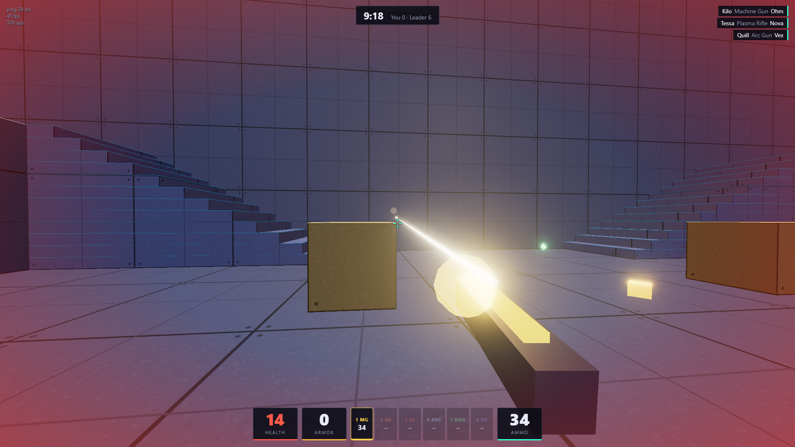
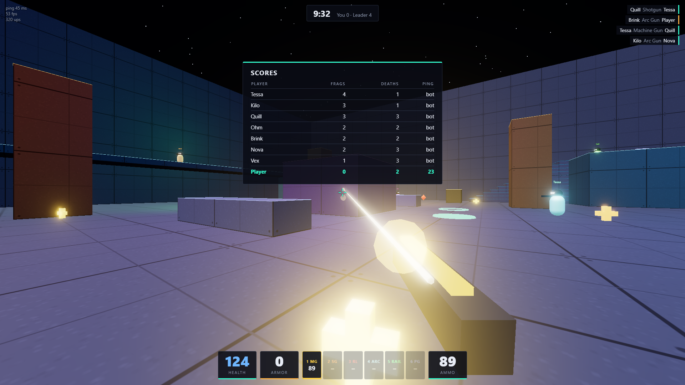
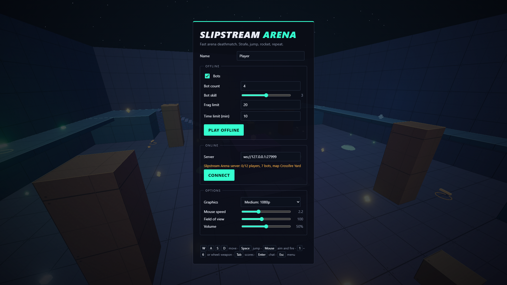

# Slipstream Arena

Slipstream Arena is an original arena shooter for the browser.
It uses the gameplay rules of the classic arena shooters of 1999:

- Fast movement with air strafe speed gain, rocket jumps, and jump pads.
- Seven weapons (a melee hammer and six guns), armor, health, and one power item (the Amplifier) on timers.
- Free-for-all deathmatch with a frag limit and a time limit.
- Bots for offline play and for the dedicated server.

The client uses [three.js](https://threejs.org/) (WebGL). The dedicated server uses Node.js and WebSocket.
The client and the server use the same simulation code in `shared/`.

## Screenshots


| | |
| --- | --- |
|  |  |
|  |  |

## Requirements

- Node.js 22 or later.
- A browser with WebGL 2.

## Quick start

```sh
npm install
npm start
```

`npm start` builds the client and starts the dedicated server.
Open `http://localhost:27960` in a browser. Then select "Play offline" or "Connect".

## Controls

| Key | Action |
| --- | --- |
| W, A, S, D | Move |
| Space | Jump |
| Mouse | Aim |
| Left mouse button | Fire |
| 1 to 7, mouse wheel | Select a weapon |
| Tab | Show the scores |
| Enter | Chat |
| Esc | Open the menu |

To gain speed, jump again and again. In the air, hold forward and one strafe key, and turn slowly to the strafe side.
The HUD shows the speed in units per second ("ups"). The ground speed limit is 320.

## Weapons

| Key | Weapon | Notes |
| --- | --- | --- |
| 1 | Hammer | Melee weapon. 50 damage at contact range. It uses no ammo, and each player always has it. |
| 2 | Machine Gun | 7 damage for each bullet, 10 bullets each second. Each player starts with it. |
| 3 | Shotgun | 11 pellets with 10 damage each. |
| 4 | Rocket Launcher | 100 damage and splash damage. The blast pushes players (rocket jump). |
| 5 | Arc Gun | Continuous beam with a range of 768 units. |
| 6 | Railgun | 100 damage. The slug goes through all players on the line. |
| 7 | Plasma Rifle | 20 damage for each ball, 10 balls each second. |

If the weapon in the hand has no ammo, the game selects a different weapon. The hammer is the last option.

## Offline play

The menu has the bot setup for the offline mode:

- "Bots" sets the bots to on or off.
- "Bot count" sets the number of bots (1 to 15).
- "Bot skill" sets the skill (1 to 5).
- "Double jump" lets each player jump one more time in the air.

During an offline game, press Esc, change the setup, and select "Apply bot setup".

## Graphics quality

The "Graphics" option in the menu limits the render resolution. The default is "Medium" (approximately 1080p).
On a 4K screen with an integrated GPU, "Native resolution" can decrease the frame rate below 60.

## Dedicated server

```sh
npm run build      # Build the web client one time.
npm run server -- --port 27960 --bots 4 --fraglimit 20
```

The server serves the web client and accepts WebSocket connections on the same port.
The server stops the simulation when no human player is connected.

| Option | Environment | Default | Description |
| --- | --- | --- | --- |
| `--port` | `PORT` | 27960 | TCP port for HTTP and WebSocket. |
| `--host` | `HOST` | 0.0.0.0 | Network address. |
| `--name` | `SERVER_NAME` | Slipstream Arena server | Server name. |
| `--maxclients` | `MAX_CLIENTS` | 12 | Maximum number of human players. |
| `--bots` | `BOTS` | 4 | Number of bots (0 to 15). 0 sets the bots to off. |
| `--botskill` | `BOT_SKILL` | 3 | Bot skill (1 to 5). |
| `--botfill` | `BOT_FILL` | on | `on`: a bot leaves when a player joins. `off`: the bot count is constant. |
| `--doublejump` | `DOUBLE_JUMP` | off | `on`: a player can jump one more time in the air. The server sends this setting to the clients. |
| `--fraglimit` | `FRAG_LIMIT` | 20 | Frags that end a match. 0 sets no limit. |
| `--timelimit` | `TIME_LIMIT` | 10 | Match time in minutes. 0 sets no limit. |

With `--botfill on`, `--bots 4` means: the server keeps a minimum of 4 players. Bots fill the free places.

### Server console

Type these commands in the terminal of the server:

| Command | Description |
| --- | --- |
| `status` | Show the players and the bot setup. |
| `bots <count> [skill]` | Set the number of bots. `bots 0` sets the bots to off. |
| `botfill <on\|off>` | Set the bot fill mode. |
| `doublejump <on\|off>` | Set the double jump. The change applies immediately. |
| `fraglimit <n>`, `timelimit <minutes>` | Change the match limits. |
| `restart` | Start the match again. |
| `say <text>` | Send a message to all players. |
| `quit` | Stop the server. |

Set `SERVER_CONSOLE=1` to use the console when the input is not a terminal.

### Status endpoint

`GET /status` returns the server name, the map, and the player counts as JSON.

### Docker

```sh
docker compose up --build -d
```

Change the settings in `compose.yaml`. To use the console in a container, add `stdin_open: true`, `tty: true`,
and run `docker attach <container>`.

### Internet hosting

- Open the TCP port of the server in the firewall.
- A page that loads over HTTPS can connect only to `wss://`. Put the server behind a reverse proxy with TLS
  (for example Caddy or nginx). The proxy must pass WebSocket connections.

## Development

```sh
npm run dev      # Vite development server for the client, with reload.
npm run server   # Dedicated server. The development client can connect to ws://localhost:27960.
npm test         # Simulation tests.
```

Useful URL parameters: `?offline` starts an offline game, `?connect=ws://host:27960` connects to a server,
`?quality=low` (or `medium`, `high`, `native`) sets the graphics quality.
`?debug` gives test scripts access to the input and the renderer as `window.game`.

## Structure

| Path | Content |
| --- | --- |
| `shared/` | Simulation: map, collision, movement, game rules, bots, game host. No browser or Node.js API. |
| `server/` | Dedicated server: HTTP, WebSocket, options, console. |
| `client/` | Web client: renderer, input, prediction, HUD, sound. |
| `test/` | Tests for the simulation and the host. |

### Network model

- The server is authoritative. It runs 60 ticks each second and sends 30 snapshots each second.
- The client sends one input command for each tick. It predicts its own movement with the shared movement code,
  and corrects the prediction from each snapshot.
- The client shows the other players a short time in the past and interpolates between two snapshots.
- The transport is WebSocket (TCP) with JSON messages, because a browser cannot use UDP sockets.
  A bad connection with packet loss can cause short stops.
- The server compensates hitscan weapons for latency. Each command has the game time that the client showed.
  The server tests the targets at their positions at that time, to a maximum of 0.3 seconds in the past.
- Rockets and plasma have no compensation. Aim ahead of the target with these weapons.
- The client asks the browser for raw mouse data. Then the pointer acceleration of the operating system does not change the aim.

### Native client

The client build uses relative paths. A desktop wrapper (for example Electron or Tauri) can load `dist/index.html`
without code changes. The offline mode runs fully in the client. A wrapper is not part of this repository.
