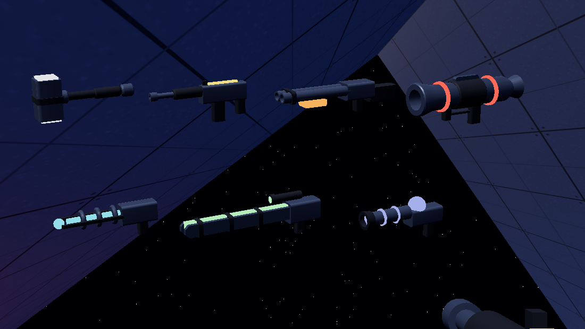
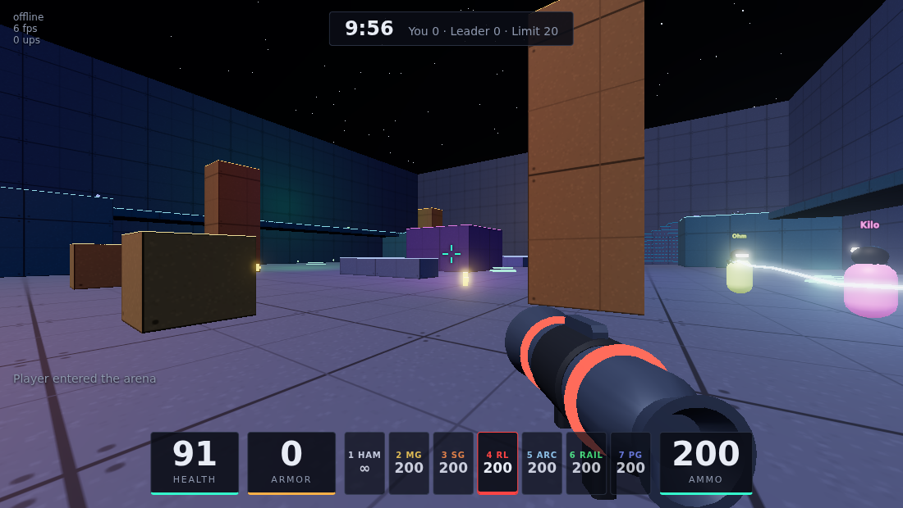
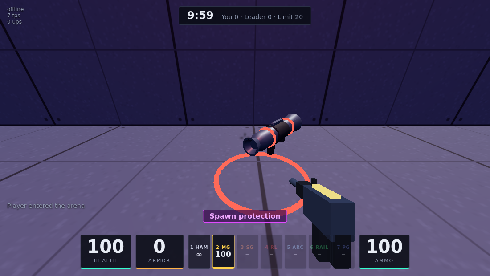
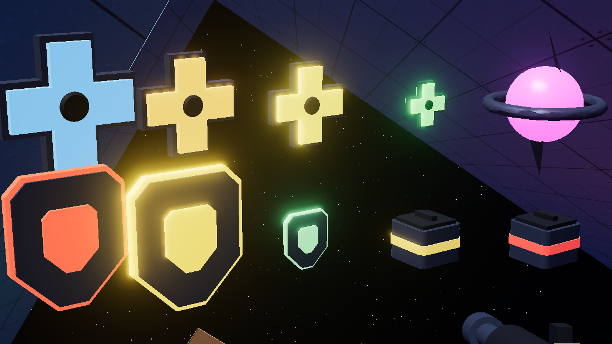
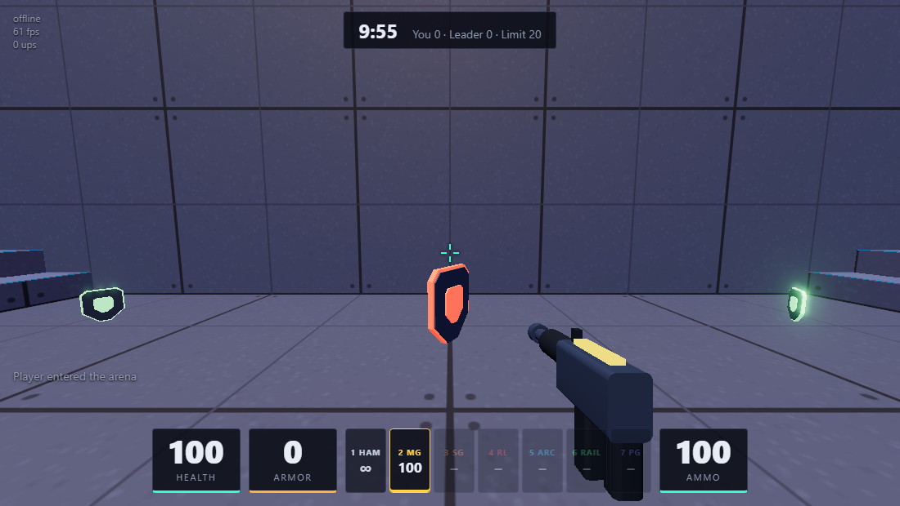

# Weapon models from a CAD program

The seven weapon models come from SolidCraft, an open-source parametric CAD program.

## Files

- `assets/weapons/<name>.sc` is the SolidCraft design of a weapon. It is the source of the model.
- `client/src/models/<name>.js` is the model data for the client. A tool makes this file. Do not edit it.
- `tools/obj-to-model.mjs` is the tool. It changes an OBJ file into the model data.
- `client/src/weapons.js` has the table `MODELS`. It gives the model data and the muzzle position of each weapon.

## Rules for a design

- 1 mm in the design is 1 unit in the game.
- The weapon points along +X. The Z axis points up. The grip is below the origin.
- The name of each body starts with the name of its material: `metal_`, `dark_` or `glow_`.
  The game gives its own material to each group. The colours in the design are only for the CAD view.

## How to make the model data

1. Open the design in SolidCraft and export it as an OBJ file.
2. Run `node tools/obj-to-model.mjs <file.obj> client/src/models/<name>.js --triangles <target>`.
3. For a new weapon, import the data in `client/src/weapons.js` and add it to `MODELS`.

The tool does these steps:

- It turns the model to the game axes. The weapon then points along -Z, and the Y axis points up.
- It decreases the number of triangles. The default target is 3000. Set a different target with `--triangles`.
- It calculates the normals again. Faces with more than 35 degrees between them get a sharp edge.
- It joins the bodies of one material into one mesh.

## Triangles and size

| Weapon | Design | Triangles from SolidCraft | Target | Triangles in the game | Data size |
|---|---|---|---|---|---|
| Hammer | `hammer.sc` | 16,092 | 1200 | 1,216 | 51 kB |
| Machine Gun | `machine-gun.sc` | 19,144 | 1500 | 1,522 | 61 kB |
| Shotgun | `shotgun.sc` | 17,716 | 1800 | 1,796 | 69 kB |
| Rocket Launcher | `rocket-launcher.sc` | 23,014 | 3000 | 3,034 | 115 kB |
| Arc Gun | `arc-gun.sc` | 23,272 | 2000 | 2,018 | 77 kB |
| Railgun | `railgun.sc` | 13,672 | 1200 | 1,284 | 51 kB |
| Plasma Rifle | `plasma-gun.sc` | 47,850 | 2000 | 1,992 | 69 kB |

## Cost

- A model from simple shapes had approximately 100 to 400 triangles.
- The model data adds approximately 470 kB to the client script (125 kB with gzip).
- The client needs no loader and no more requests. The data is a part of the script.
- A change of a model needs SolidCraft for the export. The build of the game does not need SolidCraft.

## Items

The pickup items are also models from SolidCraft. The designs are in `assets/items`.
The function `buildModel` in `client/src/weapons.js` makes a model from the data of an item.
The renderer gives each item its glow colour and its scale, thus one model is sufficient for all sizes of an item.

| Item | Design | Triangles from SolidCraft | Target | Triangles in the game | Data size |
|---|---|---|---|---|---|
| Health (four sizes) | `health.sc` | 4,604 | 400 | 480 | 20 kB |
| Armor (three sizes) | `armor.sc` | 180 | 3000 | 180 | 5 kB |
| Ammo box (one for each weapon) | `ammo.sc` | 2,632 | 500 | 518 | 18 kB |
| Amplifier | `amplifier.sc` | 87,302 | 1200 | 1,198 | 60 kB |

The armor model has flat faces only, thus the tool does not decrease its triangles.
